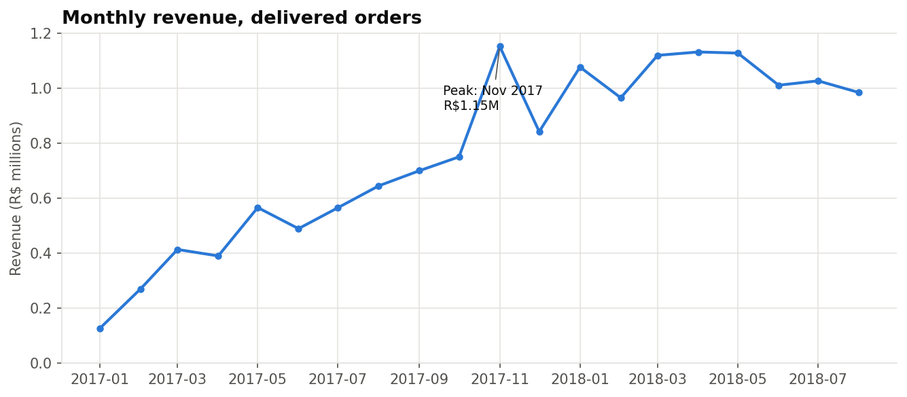
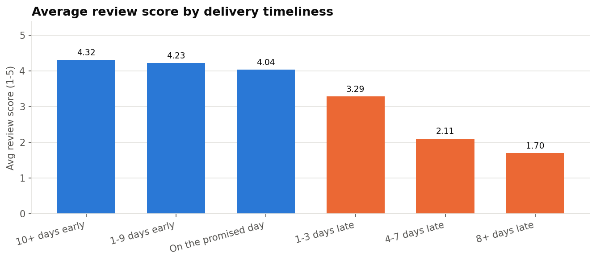
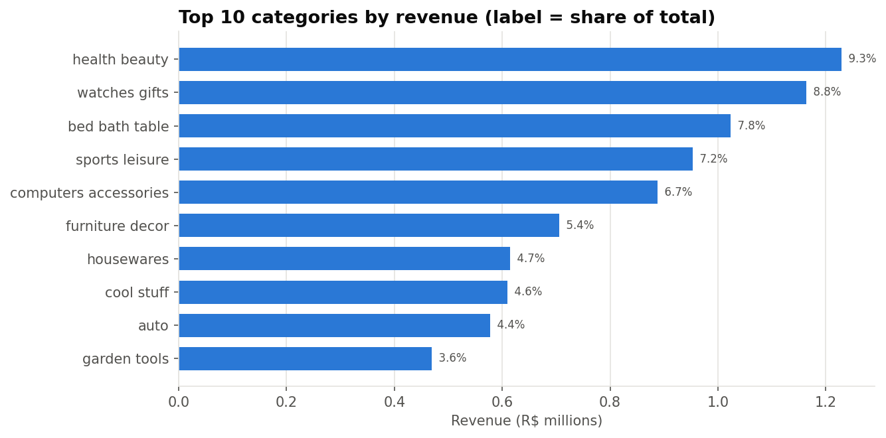
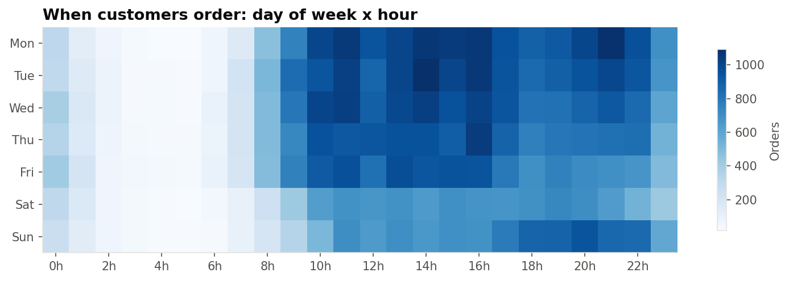
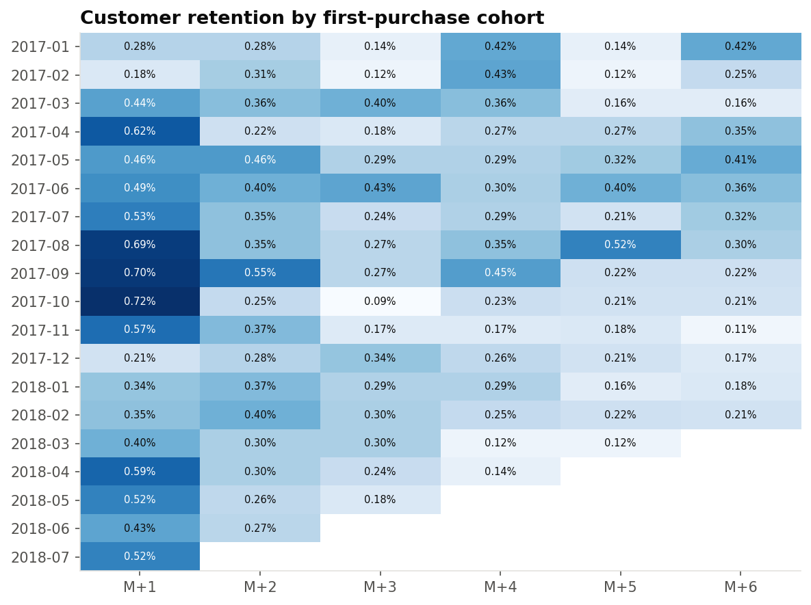
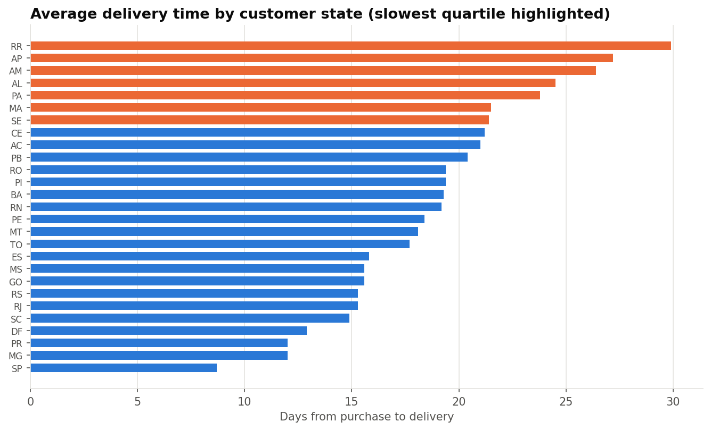
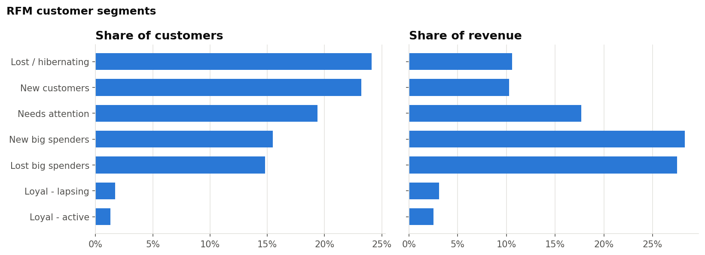
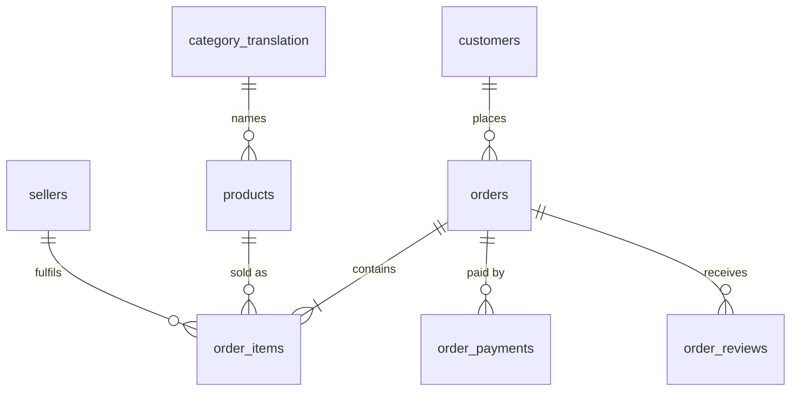

# Brazilian E-Commerce Sales Analysis (SQL + Python)

An analysis of **~100,000 real orders** from Olist, Brazil's largest department-store marketplace (2016–2018), built with **PostgreSQL** and **Python**.
The project answers 15 business questions about revenue, customers, delivery performance and satisfaction, and ends with recommendations.

**Tech:** PostgreSQL · Python · pandas · Docker

---

## Business questions

| # | Question | SQL techniques |
|---|----------|----------------|
| 1 | How is revenue trending month over month? | `DATE_TRUNC`, `LAG` window |
| 2 | When during the week do customers shop? | `EXTRACT`, pivot |
| 3 | Which categories drive revenue, and how concentrated is it? | `RANK`, running `SUM() OVER` (Pareto) |
| 4 | How do states compare on sales, delivery and reviews? | aggregates, boolean averages |
| 5 | Does late delivery hurt customer reviews? | `CASE` bucketing |
| 6 | How many customers come back? | CTE, share of total |
| 7 | Monthly cohort retention | multi-CTE, `AGE`, cohort matrix |
| 8 | RFM customer segmentation | `NTILE`, rule-based segments |
| 9 | How do customers pay? | `COUNT(DISTINCT)`, window share |
| 10 | Do bigger orders get split into more instalments? | bucketing |
| 11 | How concentrated is revenue among sellers? | `NTILE` deciles |
| 12 | Where is shipping most expensive relative to price? | ratio metrics |
| 13 | What share of orders never reach the customer? | status funnel |
| 14 | Is delivery getting faster over time? | monthly trend |
| 15 | Which big categories have the worst satisfaction? | `HAVING` |

## Key findings

**At a glance:** R$15.4M revenue from 96,211 delivered orders (Jan 2017 – Aug 2018), 93k unique customers, 3,095 sellers.

1. **The business grew fast, then levelled off.** Revenue for Jan–Aug 2018 was **+143%** on the same period of 2017. The single biggest day was **Black Friday, 24 Nov 2017, with 1,147 orders**, which made November 2017 the peak month (R$1.15M). Monthly revenue then plateaued at about R$1.0–1.1M through 2018.
2. **Late delivery is the #1 driver of bad reviews.** Orders that arrive early average **4.3 stars**. Orders 8+ days late average **1.7 stars**, and **79%** of them get a 1–2 star review. Only 6.7% of orders are late, but they cause a large share of the negative reviews.
3. **Almost nobody comes back.** **97%** of customers ordered only once, and month-1 cohort retention is under **1%**. Revenue depends entirely on acquiring new customers, which makes retention the biggest growth opportunity.
4. **Geography is a logistics problem.** São Paulo gets deliveries in **8.7 days** on average. Northern states such as Roraima, Amapá and Amazonas wait **26–30 days**. Shipping costs up to **28% of the product price** in some of these states, and Alagoas has a **21.5% late rate**.
5. **Revenue is concentrated.** The top 10% of sellers generate **67%** of revenue. 7 of 74 categories make up half of all sales, led by health & beauty, watches & gifts, and bed/bath/table.
6. **Credit card and instalments dominate.** **75%** of orders are paid by card, averaging 3.5 instalments. Payments split into 10+ instalments average **R$412**, versus R$96 for single payments, so instalments enable bigger baskets.
7. **Delivery operations improved in 2018.** After a spike in Feb–Mar 2018 (up to 19% late, reviews down to 3.8 stars), average delivery time fell from about 16 days to **7.7 days** by August 2018, and reviews recovered to 4.3 stars.
8. **Office furniture is the worst-rated large category** at **3.5 stars**, with 25% 1–2 star reviews and the slowest delivery (21 days).

### Recommendations

- **Fix delivery before spending on marketing.** Set more conservative delivery estimates for North/Northeast states, and alert customers early when an order is at risk of being late.
- **Launch a second-purchase programme**, for example a post-delivery voucher for one-time buyers. Moving repeat rate from 3% to 6% would add roughly R$0.25M a year at the current order value (about 1,700 extra orders × R$160).
- **Build a seller performance scorecard.** Top sellers carry the business, so monitor their late rates and reviews closely.
- **Plan capacity for Black Friday.** Nov 2017 saw the late rate triple (12.4%).

## Charts

| | |
|---|---|
|  |  |
|  |  |
|  |  |



All query outputs are saved as CSVs in [`results/`](results/).

## Data model

The dataset has 8 related tables. Revenue analysis uses two views built in `sql/03_create_views.sql`:

- **`v_order_facts`**: one row per order, with order value, freight, delivery time, days late and review score.
- **`v_delivered`**: delivered orders only, Jan 2017 – Aug 2018 (the months where the data is complete).



> **Note:** `customer_id` is new for every order. The real person is `customer_unique_id`, which is what the retention and RFM queries use.

## Project structure

```
olist-ecommerce-analysis/
├── data/raw/              # Kaggle CSVs go here (not committed)
├── sql/
│   ├── 01_create_tables.sql
│   ├── 02_load_data.sql
│   ├── 03_create_views.sql
│   └── analysis/          # q01 … q15, one business question per file
├── scripts/run_analysis.py  # runs everything, saves results + charts
├── results/               # query outputs as CSV
├── images/                # charts used in this README
└── docker-compose.yml     # local PostgreSQL
```

## ▶️ How to run it

1. **Get the data.** Download the [Olist dataset from Kaggle](https://www.kaggle.com/datasets/olistbr/brazilian-ecommerce) and unzip the CSVs into `data/raw/`.
2. **Start PostgreSQL.** Run `docker compose up -d`, or use any local PostgreSQL 14+ with a database called `olist`.
3. **Install the Python packages.** Run `pip install -r requirements.txt`. You also need the `psql` client on your PATH.
4. **Run the pipeline:**
   ```bash
   python scripts/run_analysis.py --setup
   ```
   This creates the tables, loads the CSVs, builds the views, runs all 15 queries into `results/` and draws the charts into `images/`.

Connection settings use the standard `PGHOST`, `PGPORT`, `PGUSER`, `PGPASSWORD` and `PGDATABASE` environment variables. The defaults match `docker-compose.yml`.

## Data source

[Brazilian E-Commerce Public Dataset by Olist](https://www.kaggle.com/datasets/olistbr/brazilian-ecommerce), released under CC BY-NC-SA 4.0. The data is real, anonymised commercial data.
